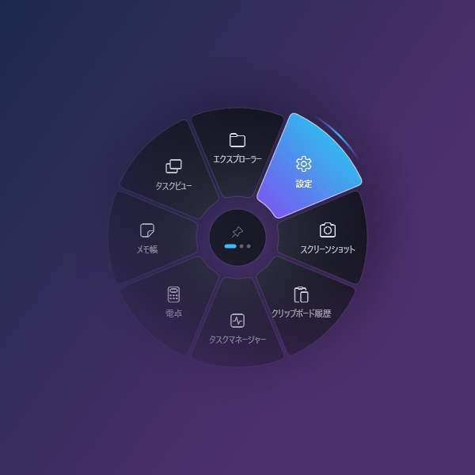
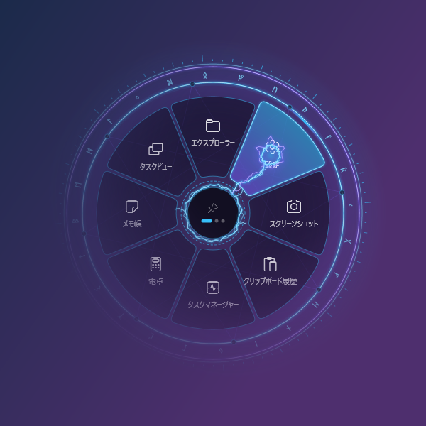
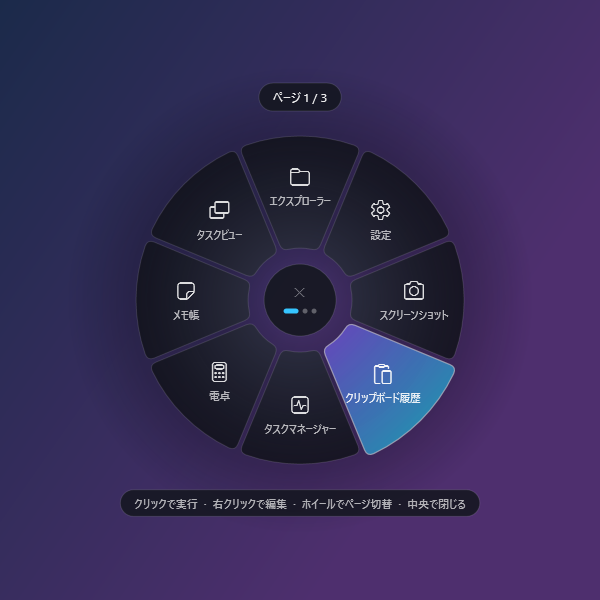
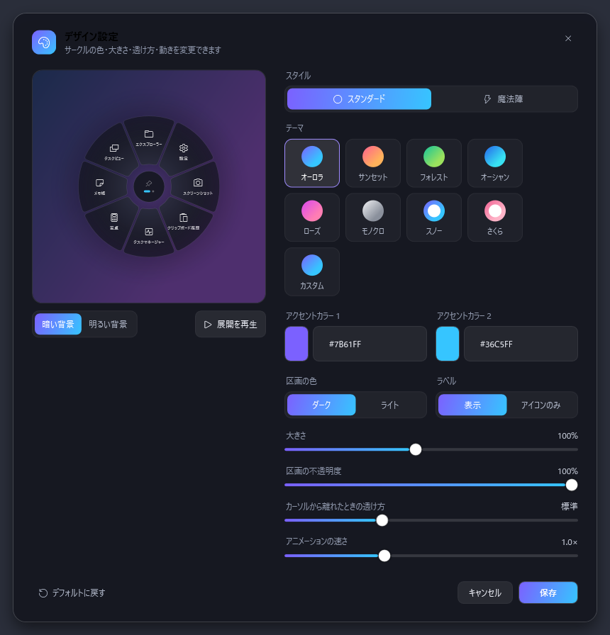

# Shortcut UI

デスクトップを長押しすると、カーソルの先端からドーナツ型のメニューが広がる Windows 用ランチャーです。1 ページ 8 区画で、初期状態は 3 ページ（合計 24 個）。ページはタスクトレイから最大 12 ページまで追加でき、キー操作・アプリ・ファイル・フォルダ・URL を割り当てられます。

*A radial shortcut launcher for Windows: long-press on the desktop to open a donut-shaped menu with 8 customizable shortcuts per page (3 pages by default, up to 12).*

| スタンダード | 魔法陣 | 固定表示 |
| :---: | :---: | :---: |
|  |  |  |



## 特長

- **カーソルの先端から展開** — 回転しながら滑らかに広がり、カーソルから離れるほど透けていくデザイン
- **複数ページ** — 1 ページ 8 区画。ホイールで切り替え、タスクトレイからページを追加
- **キー操作と起動に対応** — `Win + Shift + S` のようなキーの組み合わせ、アプリ・ファイル・フォルダ・URL の起動
- **デザイン設定** — テーマ（8 種類 + カスタムカラー）、大きさ、不透明度、透け方、アニメーション速度、ラベル表示
- **魔法陣スタイル** — ルーン文字の輪と八芒星が回転し、中央の円とカーソルを電流がつなぐ演出

## 操作方法

| 操作 | 動作 |
| --- | --- |
| デスクトップを左クリック長押し | メニューを展開 |
| 長押ししたまま区画の上で離す | その区画のショートカットを実行 |
| 長押ししたまま区画を右クリック | その区画の割り当てを編集 |
| 長押ししたままホイール | ページを切り替え |
| 長押ししたまま中央で離す | メニューを固定（開いたまま） |
| 長押ししたまま遠くへ離れる | メニューが消える |
| 固定中に区画をクリック | ショートカットを実行（空の区画なら割り当て画面） |
| 固定中に区画を右クリック | 割り当てを編集 |
| 固定中に中央 / 外側をクリック | 閉じる |

タスクトレイのアイコンを右クリックすると、「ショートカットを編集」「デザイン設定…」「ページを追加」「一時停止」「Windows 起動時に実行」「終了」を選べます。

## 動作環境

- Windows 10 / 11（x64 / ARM64）
- [.NET 9 デスクトップ ランタイム](https://dotnet.microsoft.com/download/dotnet/9.0)

## ビルドと実行

[.NET 9 SDK](https://dotnet.microsoft.com/download/dotnet/9.0) をインストールしてから実行します。

```bash
git clone https://github.com/DoraraNeko/shortcut-ui.git
cd shortcut-ui
dotnet run -c Release
```

単体の実行ファイルを作る場合:

```bash
dotnet publish -c Release -r win-x64 --self-contained false -o publish
```

開発用に、メニューの各状態を PNG に書き出すモードがあります（デザイン確認用）。

```bash
dotnet run -c Release -- --snapshot ./snapshots
```

## 設定ファイル

設定は `%APPDATA%\ShortcutUI\config.json` に保存されます。

| 項目 | 内容 |
| --- | --- |
| `HoldMilliseconds` | メニューが開くまでの長押し時間（ミリ秒、既定 300） |
| `MoveTolerance` | 長押し判定中に許容するカーソル移動量（ピクセル、既定 6） |
| `Pages` | ページごとの 8 区画の割り当て（ページの並びもこの順番） |
| `Design` | デザイン設定 |

## プライバシーとセキュリティ

- **ネットワーク通信は行いません。** 利用状況の収集・送信もありません。
- デスクトップ上の長押しを検出するため、**グローバルなマウスフック**（`WH_MOUSE_LL`）を使用します。マウスの位置とボタンの状態は長押しの判定とメニューの操作にのみ使い、記録・保存はしません。キーボード入力の監視は行いません。
- キー操作のショートカットは `SendInput` で送信します。管理者権限で動いているアプリには、Windows の仕様（UIPI）によりキー操作が届かない場合があります。また、`Win + L` などシステムが保護しているキーは送信できません（ロックは「PCをロック」のプリセットを使用してください）。
- 設定とエラーログ（`error.log`）は `%APPDATA%\ShortcutUI` にのみ保存されます。

## 注意事項

- 本ソフトウェアは無保証です。詳しくは [LICENSE](LICENSE) をご覧ください。
- 表示には Windows に標準搭載のフォント（Segoe UI / Segoe Fluent Icons / Segoe UI Historic など）を使用しています。フォントは本リポジトリに含まれていません。
- Windows は米国 Microsoft Corporation の米国およびその他の国における登録商標です。本ソフトウェアは Microsoft とは関係のない個人の制作物です。

## ライセンス

[MIT License](LICENSE)
